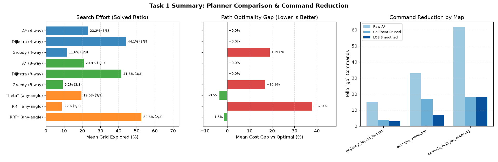
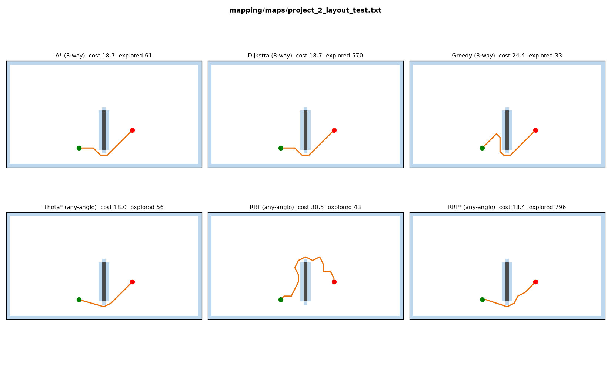
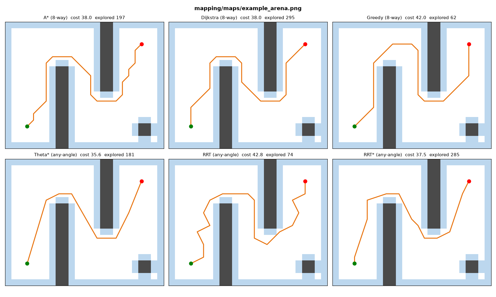
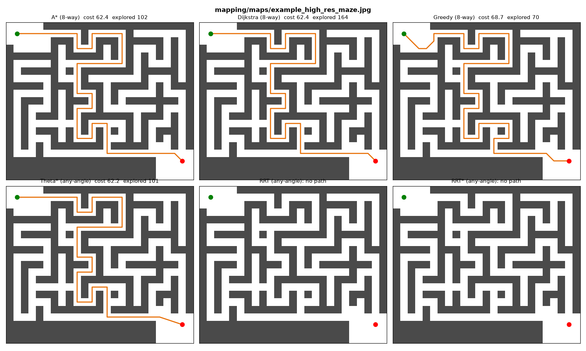
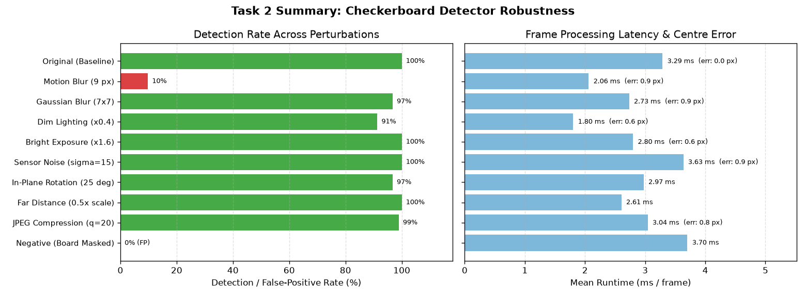

# Benchmark Summary

> Generated on 25 Nov 2026

## 1. Scorecard

| Stage | Pipeline Method | Alternatives Tested | Key Measured Results |
|---|---|---|---|
| **Mapping** | `load_map` + `inflate(10 cm)` | jpg, png, txt | 3 maps loaded (0 failed); load time 0.8–12.7 ms |
| **Path Planner** | A\* 8-way (`plan_path`) | Dijkstra, Greedy, Theta\*, RRT, RRT\* | Optimal on 3/3 maps; explores 33–89% fewer cells than Dijkstra; Greedy +10.0% to +30.2%, RRT +12.8% to +63.1% cost vs Optimal |
| **Waypoints / Commands** | LOS smoothing (`plan_path`) | Raw A\*, collinear pruning | `go` commands reduced by 71–80% vs raw A\* (0 invalid SDK commands) |
| **Board Detector** | `detect_board` (Canny + quad + checker contrast) | 9 perturbations + negative control | Baseline 100%; 10–100% across perturbations; centre error 0.0–0.9 px; 2.8 ms/frame mean; 0 FP / 92 masked frames |

## 2. Task 1: Navigation

### 2.1 Mapping

10 cm safety margin; falls back to raw grid if inflation blocks the 4-way route.

| Map | Format | Grid | Cells | Cell (cm) | Load (ms) | Obstacles (Raw) | Obstacles (Inflated) | Inflation Status |
|---|---|---|---:|---:|---:|---:|---:|---|
| `mapping/maps/project_2_layout_test.txt` | `txt` | 30x55 | 1650 | 20.0 | 0.8 | 0.7% | 12.2% | Applied |
| `mapping/maps/example_arena.png` | `png` | 20x25 | 500 | 20.0 | 12.7 | 10.4% | 38.0% | Applied |
| `mapping/maps/example_high_res_maze.jpg` | `jpg` | 21x25 | 525 | 20.0 | 8.2 | 52.8% | 96.6% | Skipped (blocks route) |

### 2.2 Planner Summary

Median of 3 runs per map; optimal baseline = Dijkstra (`any-angle` vs 8-way). Pipeline default (**A\* 8-way**) is bolded.

| Algorithm | Connectivity | Solved Maps | Mean Grid Explored | Median Runtime (ms) | Mean Runtime (ms) | Mean Gap vs Optimal | Cost Gap Range |
|---|---|---:|---:|---:|---:|---:|---:|
| A* | 4-way | 3/3 | 23.2% | 0.19 | 0.19 | Optimal (0.0%) | Optimal (0.0%) |
| Dijkstra | 4-way | 3/3 | 44.1% | 0.35 | 0.47 | Optimal (0.0%) | Optimal (0.0%) |
| Greedy | 4-way | 3/3 | 11.6% | 0.09 | 0.09 | +19.0% | +6.3% to +41.7% |
| **A\*** | **8-way** | 3/3 | 20.8% | 0.18 | 0.28 | Optimal (0.0%) | Optimal (0.0%) |
| Dijkstra | 8-way | 3/3 | 41.6% | 0.66 | 0.76 | Optimal (0.0%) | Optimal (0.0%) |
| Greedy | 8-way | 3/3 | 9.2% | 0.12 | 0.12 | +16.9% | +10.0% to +30.2% |
| Theta* | any-angle | 3/3 | 19.6% | 32.16 | 58.13 | -3.5% | -6.2% to -0.4% |
| RRT | any-angle | 2/3 | 8.7% | 0.59 | 0.59 | +37.9% | +12.8% to +63.1% |
| RRT* | any-angle | 2/3 | 52.6% | 180.93 | 180.93 | -1.5% | -1.7% to -1.3% |

### 2.3 Waypoints & Commands

Raw 8-way A\* vs collinear pruning vs LOS smoothing (`plan_path`). Out-of-range: all axes < 20 cm or any axis > 500 cm.

| Map | Waypoints (Raw) | Waypoints (Pruned) | Waypoints (Smoothed) | `go` Cmds (Raw) | `go` Cmds (Pruned) | `go` Cmds (Smoothed) | Cmd Reduction | Out-of-Range `go` |
|---|---:|---:|---:|---:|---:|---:|---:|---:|
| `mapping/maps/project_2_layout_test.txt` | 16 | 5 | **4** | 15 | 4 | **3** | **-80%** | 0 / 0 / 0 |
| `mapping/maps/example_arena.png` | 34 | 18 | **8** | 33 | 17 | **7** | **-79%** | 0 / 0 / 0 |
| `mapping/maps/example_high_res_maze.jpg` | 63 | 19 | **19** | 62 | 18 | **18** | **-71%** | 0 / 0 / 0 |
| **Mean across 3 maps** | 37.7 | 14.0 | **10.3** | 36.7 | 13.0 | **9.3** | **-77%** | 0 / 0 / 0 |

### 2.4 Per-Map Results

Dark grey = obstacle, light blue = safety margin, orange = path, green = start, red = goal.

#### `mapping/maps/project_2_layout_test.txt` (30x55, 1650 cells — inflation: applied)

| Algorithm | Connectivity | Path Cost (cells) | Explored | % of Grid | Runtime (ms) | vs Optimal |
|---|---|---:|---:|---:|---:|---|
| A* | 4-way | 24.00 | 134 | 8.1% | 0.19 | Optimal (0.0%) |
| Dijkstra | 4-way | 24.00 | 682 | 41.3% | 0.88 | Optimal (0.0%) |
| Greedy | 4-way | 34.00 | 71 | 4.3% | 0.09 | +41.7% |
| A* | 8-way | 18.73 | 61 | 3.7% | 0.16 | Optimal (0.0%) |
| Dijkstra | 8-way | 18.73 | 570 | 34.5% | 1.35 | Optimal (0.0%) |
| Greedy | 8-way | 24.38 | 33 | 2.0% | 0.08 | +30.2% |
| Theta* | any-angle | 18.00 | 56 | 3.4% | 32.16 | -3.9% |
| RRT | any-angle | 30.54 | 43 | 2.6% | 0.21 | +63.1% |
| RRT* | any-angle | 18.42 | 796 | 48.2% | 265.95 | -1.7% |

#### `mapping/maps/example_arena.png` (20x25, 500 cells — inflation: applied)

| Algorithm | Connectivity | Path Cost (cells) | Explored | % of Grid | Runtime (ms) | vs Optimal |
|---|---|---:|---:|---:|---:|---|
| A* | 4-way | 45.00 | 211 | 42.2% | 0.27 | Optimal (0.0%) |
| Dijkstra | 4-way | 45.00 | 296 | 59.2% | 0.35 | Optimal (0.0%) |
| Greedy | 4-way | 49.00 | 87 | 17.4% | 0.11 | +8.9% |
| A* | 8-way | 37.97 | 197 | 39.4% | 0.48 | Optimal (0.0%) |
| Dijkstra | 8-way | 37.97 | 295 | 59.0% | 0.66 | Optimal (0.0%) |
| Greedy | 8-way | 41.97 | 62 | 12.4% | 0.15 | +10.5% |
| Theta* | any-angle | 35.60 | 181 | 36.2% | 127.77 | -6.2% |
| RRT | any-angle | 42.84 | 74 | 14.8% | 0.97 | +12.8% |
| RRT* | any-angle | 37.47 | 285 | 57.0% | 95.91 | -1.3% |

#### `mapping/maps/example_high_res_maze.jpg` (21x25, 525 cells — inflation: skipped (blocks route))

| Algorithm | Connectivity | Path Cost (cells) | Explored | % of Grid | Runtime (ms) | vs Optimal |
|---|---|---:|---:|---:|---:|---|
| A* | 4-way | 63.00 | 101 | 19.2% | 0.12 | Optimal (0.0%) |
| Dijkstra | 4-way | 63.00 | 167 | 31.8% | 0.17 | Optimal (0.0%) |
| Greedy | 4-way | 67.00 | 69 | 13.1% | 0.07 | +6.3% |
| A* | 8-way | 62.41 | 102 | 19.4% | 0.18 | Optimal (0.0%) |
| Dijkstra | 8-way | 62.41 | 164 | 31.2% | 0.26 | Optimal (0.0%) |
| Greedy | 8-way | 68.66 | 70 | 13.3% | 0.12 | +10.0% |
| Theta* | any-angle | 62.16 | 101 | 19.2% | 14.46 | -0.4% |
| RRT | any-angle | no path | — | — | — | — |
| RRT* | any-angle | no path | — | — | — | — |

---

## 3. Task 2: Checkerboard Tracking

92 frames (every 3rd frame) from `data/Tello_video.mp4`. Centre error measured vs unmodified frame.

| Condition | Simulated Scenario | Detection Rate | Mean Centre Error | Runtime (ms/frame) |
|---|---|---:|---:|---:|
| Original (Baseline) | Unmodified Tello flight stream | 100% | 0.0 px | 3.29 |
| Motion Blur (9 px) | Rapid drone pitch/roll gust | 10% | 0.9 px | 2.06 |
| Gaussian Blur (7x7) | Camera defocus / vibration | 97% | 0.9 px | 2.73 |
| Dim Lighting (x0.4) | Shadowed arena corner | 91% | 0.6 px | 1.80 |
| Bright Exposure (x1.6) | Overhead spotlight glare | 100% | 0.6 px | 2.80 |
| Sensor Noise (sigma=15) | High ISO gain noise | 100% | 0.9 px | 3.63 |
| In-Plane Rotation (25 deg) | Tilted board / banked drone | 97% | N/A | 2.97 |
| Far Distance (0.5x scale) | Drone hovering at 2x distance | 100% | N/A | 2.61 |
| JPEG Compression (q=20) | Heavy Wi-Fi UDP packet artefacts | 99% | 0.8 px | 3.04 |
| **Negative (board masked)** | Board occluded; clutter rejection | 0 FP / 92 frames (0%) | — | 3.70 |

